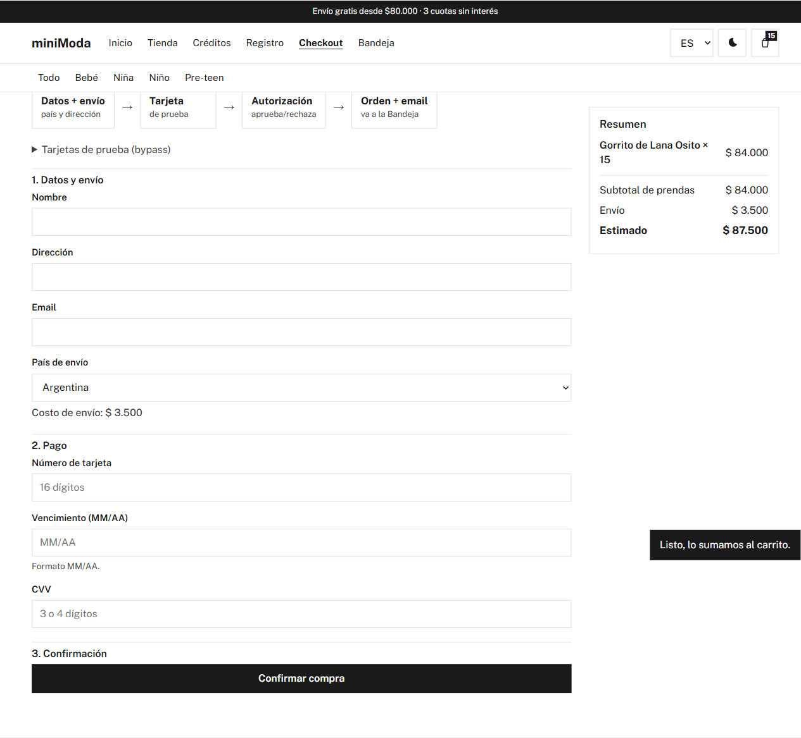
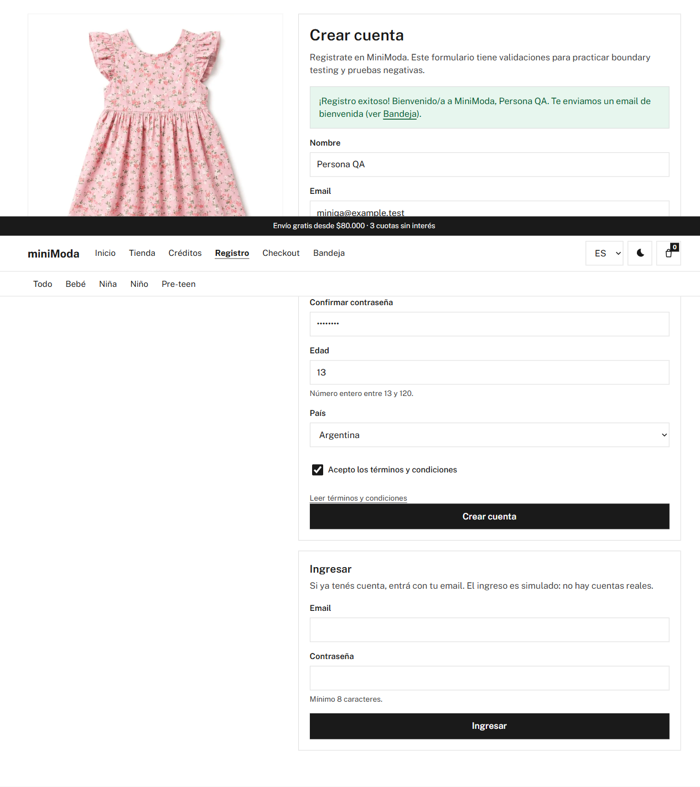
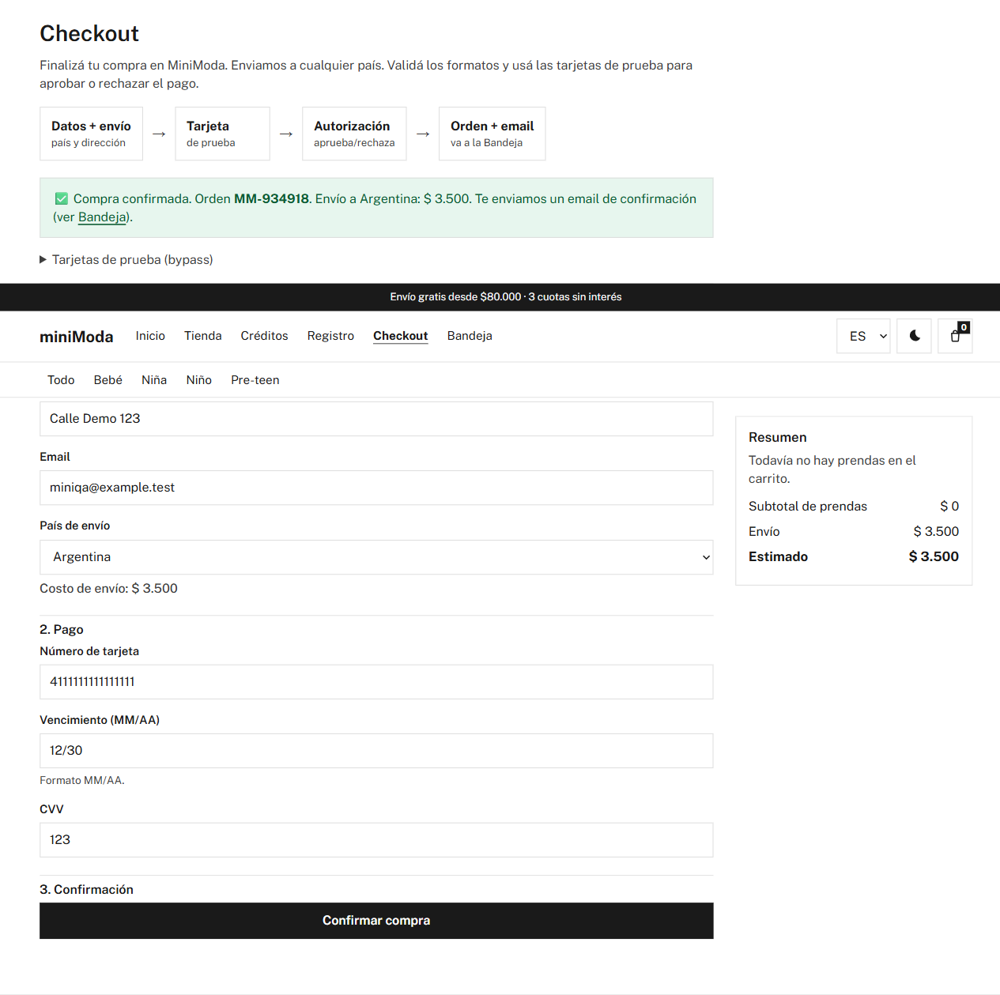

# Seguimiento del issue #7

[Comentario original](https://github.com/Simonethg/minimoda-test/issues/7#issuecomment-6935434971)

## Cambios después del feedback · Pablo Villeda

Reejecuté C5-03, C5-06 y C5-09 en la [demo de MiniModa](https://minimoda-navy.vercel.app/) con datos sintéticos y contextos aislados. Las diferencias se registran contra las fuentes del kit. La causa y la regla vigente quedan abiertas.

| Caso | Esperado según el kit | Observado |
| --- | --- | --- |
| C5-03 · Envío | Con $84.000 en Argentina, el envío debería ser gratis bajo cualquiera de los dos umbrales documentados. | Envío de $3.500 y total estimado de $87.500. |
| C5-06 · Registro | HIST-12 exige un mínimo de 18 años. | Registro exitoso a los 13 años. |
| C5-09 · Carrito vacío | Manual §3, HIST-18 y changelog 0.9.1 indican que se bloquea la confirmación. | Compra confirmada mientras el resumen indicaba que no había prendas. |

**Qase.** El CSV de C5-03, C5-06 y C5-09 se preparó para la suite «Clase 5 · Exploratorio MiniModa». La importación, el run y los adjuntos en Qase siguen pendientes. Las capturas corresponden a Playwright.

### Decisiones para el equipo

| Ref. | Fuente y observación | Hipótesis y pregunta |
| --- | --- | --- |
| I-01 · /checkout | Manual §3, HIST-18 y changelog 0.9.1 esperan un bloqueo. Se confirmó una orden simulada desde el checkout directo sin prendas. | El acceso directo podría aplicar una validación distinta. ¿En qué etapa debe bloquearse? |
| I-02 · /checkout | El manual y el sprint indican $50.000; el changelog y Lucas indican $80.000. Con 15 gorritos y subtotal $84.000, Argentina mostró $3.500 de envío. | Podría existir una condición adicional o un anuncio desactualizado. ¿Qué umbral y base corresponden? |
| I-03 · /registro | HIST-12 indica 18 años. Con los demás campos válidos, la demo rechazó 12 y aceptó 13 y 17. | El criterio podría haber cambiado. ¿La edad mínima vigente es 13 o 18? |
| I-04 · /creditos | Manual §5 e HIST-21 describen cuotas sin interés. Al solicitar $10.000 en tres cuotas se sumaron $1.000 de interés. | La ficha y Créditos podrían mostrar modalidades distintas. ¿Ese 10% es intencional? |
| I-05 · /checkout | Manual §3 y changelog 0.9.1 describen MINIMODA10. Con un gorrito no apareció un control para introducirlo. El descuento queda **A VERIFICAR**. | El cupón podría estar retirado o sujeto a otra condición. ¿Sigue vigente y dónde se ingresa? |
| I-06 · /carrito | Manual §2 indica que las prendas persisten. Tras añadir 15 gorritos y recargar, el contador cayó a cero. | Coincide con la pérdida advertida por Lucas. ¿La persistencia es un requisito vigente? |
| I-07 · /ayuda | Manual §6, README y changelog 0.8.0 presentan Ayuda como disponible. No apareció en el pie y la ruta respondió 404. | La página podría seguir pendiente. ¿Debe restaurarse o actualizarse el kit? |

Para cada diferencia sigue abierta la clasificación: [ ] app, [ ] información del kit, [ ] decisión del equipo. Los pasos y extractos completos están en las secciones de casos y evidencia del issue.

### Capturas de la reproducción

[CSV para importar en Qase](clase-05-qase.csv)
