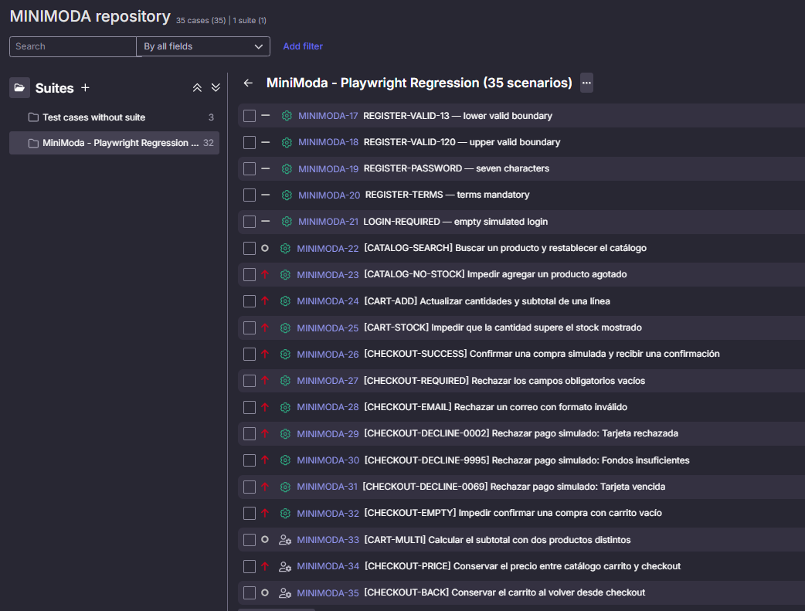

# Test Cases de Checkout QASE

Los IDs de este inventario aparecen en la captura de la suite **MiniModa - Playwright Regression (35 scenarios)**. Los pasos, las precondiciones y los resultados esperados provienen del inventario CSV preparado para Qase. [Proyecto MINIMODA](https://app.qase.io/project/MINIMODA)

## Trazabilidad de la ejecución

La ejecución local en Chromium registró **8 aprobados y 1 fallido (88,9 %)**. El caso `MINIMODA-32` reprodujo la confirmación de una compra simulada con el carrito vacío. En el reintento, el checkout y la bandeja mostraron la orden `MM-252193`. Los resultados de esta tabla provienen de Playwright. [Reporte y evidencia de la ejecución](../Checkout/reporte-checkout.md)

### Casos de checkout ejecutados

| ID en Qase | Referencia local | Resultado de la ejecución de checkout |
| --- | --- | --- |
| MINIMODA-26 | CHECKOUT-SUCCESS | Aprobado |
| MINIMODA-27 | CHECKOUT-REQUIRED | Aprobado |
| MINIMODA-28 | CHECKOUT-EMAIL | Aprobado |
| MINIMODA-29 | CHECKOUT-DECLINE-0002 | Aprobado |
| MINIMODA-30 | CHECKOUT-DECLINE-9995 | Aprobado |
| MINIMODA-31 | CHECKOUT-DECLINE-0069 | Aprobado |
| MINIMODA-32 | CHECKOUT-EMPTY | Fallido · MM-QA-EMPTY |
| MINIMODA-34 | CHECKOUT-PRICE | Aprobado |
| MINIMODA-35 | CHECKOUT-BACK | Aprobado |

### Casos de apoyo de catálogo, carrito e inventario

| ID en Qase | Referencia local | Resultado de la ejecución de checkout |
| --- | --- | --- |
| MINIMODA-22 | CATALOG-SEARCH | Fuera del alcance |
| MINIMODA-23 | CATALOG-NO-STOCK | Fuera del alcance |
| MINIMODA-24 | CART-ADD | Fuera del alcance |
| MINIMODA-25 | CART-STOCK | Fuera del alcance |
| MINIMODA-33 | CART-MULTI | Fuera del alcance |

## Casos de checkout ejecutados

### MINIMODA-26 · Confirmar una compra simulada y recibir una confirmación

**Precondiciones.** Contexto de navegador aislado en la demo pública de MiniModa. Bandeja simulada vacía. Agregar un Gorrito de Lana Osito en stock y abrir checkout desde el carrito.

| Paso | Acción | Resultado esperado | Datos de prueba |
| ---: | --- | --- | --- |
| 1 | Revisar el resumen | Se muestra un gorrito con el subtotal correspondiente | — |
| 2 | Completar los datos sintéticos y pulsar Confirmar compra una vez | Aparece Compra confirmada y una referencia MM seguida de dígitos | QA Automation / 123 Demo Street / qa.automation@example.test / Argentina / 4111111111111111 / vencimiento futuro MM/YY / CVV 123 |
| 3 | Abrir Bandeja | Hay un solo correo con la misma referencia y el email de prueba | — |

**Postcondición.** Cerrar el contexto aislado para descartar los datos de prueba.

### MINIMODA-27 · Rechazar los campos obligatorios vacíos

**Precondiciones.** Contexto de navegador aislado en la demo pública de MiniModa. Agregar un Gorrito de Lana Osito en stock y abrir checkout desde el carrito.

| Paso | Acción | Resultado esperado | Datos de prueba |
| ---: | --- | --- | --- |
| 1 | Pulsar Confirmar compra con el formulario vacío | Se muestran seis errores obligatorios de nombre y dirección y email y tarjeta y vencimiento y CVV | — |
| 2 | Revisar el checkout y la bandeja simulada | No aparece una confirmación ni un correo de pedido | — |

**Postcondición.** Cerrar el contexto aislado para descartar los datos de prueba.

### MINIMODA-28 · Rechazar un correo con formato inválido

**Precondiciones.** Contexto de navegador aislado en la demo pública de MiniModa. Agregar un Gorrito de Lana Osito en stock y abrir checkout desde el carrito.

| Paso | Acción | Resultado esperado | Datos de prueba |
| ---: | --- | --- | --- |
| 1 | Completar los datos de prueba y sustituir el email | El formulario contiene el correo inválido | QA Automation / 123 Demo Street / qa.automation@example.test / Argentina / 4111111111111111 / vencimiento futuro MM/YY / CVV 123 / email invalid-email |
| 2 | Pulsar Confirmar compra | El campo Email se marca inválido y la compra no se confirma | — |
| 3 | Revisar la bandeja simulada | No aparece un correo de pedido | — |

**Postcondición.** Cerrar el contexto aislado para descartar los datos de prueba.

### MINIMODA-29 · Rechazar pago simulado: Tarjeta rechazada

**Precondiciones.** Contexto de navegador aislado en la demo pública de MiniModa. Agregar un Gorrito de Lana Osito en stock y abrir checkout desde el carrito.

| Paso | Acción | Resultado esperado | Datos de prueba |
| ---: | --- | --- | --- |
| 1 | Completar el formulario con la tarjeta simulada indicada | Los datos de prueba quedan cargados | QA Automation / 123 Demo Street / qa.automation@example.test / Argentina / 4000000000000002 / vencimiento futuro MM/YY / CVV 123 |
| 2 | Pulsar Confirmar compra | Aparece Tarjeta rechazada y la compra no se confirma | — |
| 3 | Revisar el resumen y la bandeja simulada | El gorrito sigue en el resumen y no aparece un correo de pedido | — |

**Postcondición.** Cerrar el contexto aislado para descartar los datos de prueba.

### MINIMODA-30 · Rechazar pago simulado: Fondos insuficientes

**Precondiciones.** Contexto de navegador aislado en la demo pública de MiniModa. Agregar un Gorrito de Lana Osito en stock y abrir checkout desde el carrito.

| Paso | Acción | Resultado esperado | Datos de prueba |
| ---: | --- | --- | --- |
| 1 | Completar el formulario con la tarjeta simulada indicada | Los datos de prueba quedan cargados | QA Automation / 123 Demo Street / qa.automation@example.test / Argentina / 4000000000009995 / vencimiento futuro MM/YY / CVV 123 |
| 2 | Pulsar Confirmar compra | Aparece Fondos insuficientes y la compra no se confirma | — |
| 3 | Revisar el resumen y la bandeja simulada | El gorrito sigue en el resumen y no aparece un correo de pedido | — |

**Postcondición.** Cerrar el contexto aislado para descartar los datos de prueba.

### MINIMODA-31 · Rechazar pago simulado: Tarjeta vencida

**Precondiciones.** Contexto de navegador aislado en la demo pública de MiniModa. Agregar un Gorrito de Lana Osito en stock y abrir checkout desde el carrito.

| Paso | Acción | Resultado esperado | Datos de prueba |
| ---: | --- | --- | --- |
| 1 | Completar el formulario con la tarjeta simulada indicada | Los datos de prueba quedan cargados | QA Automation / 123 Demo Street / qa.automation@example.test / Argentina / 4000000000000069 / vencimiento futuro MM/YY / CVV 123 |
| 2 | Pulsar Confirmar compra | Aparece Tarjeta vencida y la compra no se confirma | — |
| 3 | Revisar el resumen y la bandeja simulada | El gorrito sigue en el resumen y no aparece un correo de pedido | — |

**Postcondición.** Cerrar el contexto aislado para descartar los datos de prueba.

### MINIMODA-32 · Impedir confirmar una compra con carrito vacío

**Precondiciones.** Contexto de navegador aislado en la demo pública de MiniModa. Carrito y bandeja vacíos.

| Paso | Acción | Resultado esperado | Datos de prueba |
| ---: | --- | --- | --- |
| 1 | Verificar el contador en /carrito | El contador indica cero | — |
| 2 | Abrir /checkout directamente | No se genera una orden por abrir la ruta | — |
| 3 | Si aparece un formulario habilitado completar datos de demo e intentar confirmar | El checkout impide confirmar una orden sin productos | QA Automation / 123 Demo Street / qa.automation@example.test / Argentina / 4111111111111111 / vencimiento futuro MM/YY / CVV 123 |
| 4 | Revisar la bandeja simulada | No aparece un correo de pedido | — |

**Postcondición.** Cerrar el contexto aislado para descartar los datos de prueba.

### MINIMODA-34 · Conservar el precio entre catálogo carrito y checkout

**Precondiciones.** Contexto de navegador aislado en la demo pública de MiniModa. Un producto con dos unidades disponibles.

| Paso | Acción | Resultado esperado | Datos de prueba |
| ---: | --- | --- | --- |
| 1 | Registrar el precio unitario y agregar dos unidades | El subtotal del carrito es el doble del precio | — |
| 2 | Abrir checkout desde el carrito | El subtotal del checkout coincide con el del carrito | — |
| 3 | Comparar el total con el subtotal y el envío visibles | El total es igual al subtotal más el envío | — |

**Postcondición.** Cerrar el contexto aislado para descartar los datos de prueba.

### MINIMODA-35 · Conservar el carrito al volver desde checkout

**Precondiciones.** Contexto de navegador aislado en la demo pública de MiniModa. Un producto en stock.

| Paso | Acción | Resultado esperado | Datos de prueba |
| ---: | --- | --- | --- |
| 1 | Agregar una unidad y abrir el carrito | El producto figura con cantidad uno | — |
| 2 | Abrir checkout y volver con Atrás del navegador | Se muestra el carrito con el mismo producto y cantidad | — |
| 3 | Abrir checkout nuevamente desde el carrito | Se conserva la línea y el subtotal | — |

**Postcondición.** Cerrar el contexto aislado para descartar los datos de prueba.

## Casos de apoyo de catálogo, carrito e inventario

### MINIMODA-22 · Buscar un producto y restablecer el catálogo

**Precondiciones.** Contexto de navegador aislado en la demo pública de MiniModa.

| Paso | Acción | Resultado esperado | Datos de prueba |
| ---: | --- | --- | --- |
| 1 | Abrir la tienda y anotar el catálogo inicial | Los productos iniciales están visibles | — |
| 2 | Buscar Gorrito de Lana Osito | Se muestra la coincidencia del gorrito | — |
| 3 | Pulsar Limpiar filtros | Se restablece el catálogo inicial | — |

**Postcondición.** Cerrar el contexto aislado para descartar los datos de prueba.

### MINIMODA-23 · Impedir agregar un producto agotado

**Precondiciones.** Contexto de navegador aislado en la demo pública de MiniModa. Hay un producto agotado.

| Paso | Acción | Resultado esperado | Datos de prueba |
| ---: | --- | --- | --- |
| 1 | Abrir la tienda y localizar un producto agotado | El producto muestra Sin stock | — |
| 2 | Revisar su acción y el contador del carrito | La acción está deshabilitada y el contador queda en cero | — |

**Postcondición.** Cerrar el contexto aislado para descartar los datos de prueba.

### MINIMODA-24 · Actualizar cantidades y subtotal de una línea

**Precondiciones.** Contexto de navegador aislado en la demo pública de MiniModa. Gorrito con al menos dos unidades en stock.

| Paso | Acción | Resultado esperado | Datos de prueba |
| ---: | --- | --- | --- |
| 1 | Registrar el precio del gorrito y agregar una unidad | El carrito muestra una unidad y el precio unitario | — |
| 2 | Incrementar a dos unidades | El subtotal es el doble del precio unitario | — |
| 3 | Reducir a una unidad | El subtotal coincide con el precio unitario | — |
| 4 | Quitar la unidad restante | El carrito queda vacío y la acción de checkout está deshabilitada | — |

**Postcondición.** Cerrar el contexto aislado para descartar los datos de prueba.

### MINIMODA-25 · Impedir que la cantidad supere el stock mostrado

**Precondiciones.** Contexto de navegador aislado en la demo pública de MiniModa. Producto con stock positivo y manejable.

| Paso | Acción | Resultado esperado | Datos de prueba |
| ---: | --- | --- | --- |
| 1 | Registrar el stock visible y agregar una unidad al carrito | La cantidad inicial es uno | — |
| 2 | Aumentar la cantidad hasta el stock visible | La cantidad llega al límite registrado | — |
| 3 | Intentar aumentar una unidad más | La cantidad no supera el stock registrado | — |

**Postcondición.** Cerrar el contexto aislado para descartar los datos de prueba.

### MINIMODA-33 · Calcular el subtotal con dos productos distintos

**Precondiciones.** Contexto de navegador aislado en la demo pública de MiniModa. Dos productos en stock y dos unidades disponibles del primero.

| Paso | Acción | Resultado esperado | Datos de prueba |
| ---: | --- | --- | --- |
| 1 | Registrar ambos precios y agregar una unidad de cada producto | El carrito muestra dos líneas y el subtotal suma ambos precios | — |
| 2 | Aumentar a dos unidades del primer producto | La segunda línea mantiene una unidad y el subtotal se recalcula | — |
| 3 | Quitar el primer producto | Solo queda el segundo producto y su precio coincide con el subtotal | — |

**Postcondición.** Cerrar el contexto aislado para descartar los datos de prueba.
